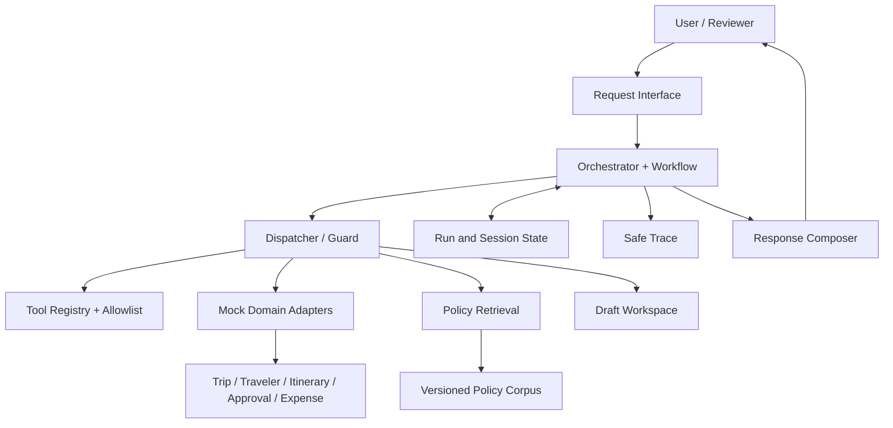

# 01 — Kiến trúc Agent

## 1. Mục tiêu thiết kế

Xây dựng prototype có thể hỗ trợ người đi công tác và Travel Operations qua ba workflow: chuẩn bị trước chuyến đi, hỗ trợ khi lịch trình gián đoạn, và kiểm tra chi phí sau chuyến đi. Agent điều phối các bước có giới hạn; dữ liệu nghiệp vụ đến từ mock systems; mọi kết luận về policy phải truy vết được tới evidence.

## 2. Nguyên tắc kiến trúc

- **Mock-only:** mọi hệ thống nghiệp vụ là giả lập; không kết nối production.
- **Tool-mediated access:** Agent không đọc trực tiếp database, file, network hay shell. Mọi truy cập nghiệp vụ qua tool registry và dispatcher.
- **Policy is evidence, not authority:** policy có thể hỗ trợ giải thích/đề xuất; policy không cấp quyền để đặt dịch vụ, thanh toán, gửi thông tin hoặc ghi dữ liệu nghiệp vụ.
- **Deterministic controls:** schema validation, quyền, ngân sách, tính tổng expense và trạng thái approval được kiểm tra bằng code.
- **Draft-only side effects:** thao tác giống ghi chỉ được tạo artifact/approval record trong sandbox; không publish hoặc gửi thật.
- **Observable execution:** mỗi run ghi trace an toàn đủ để hiểu tool nào chạy, quan sát được gì và vì sao dừng.

## 3. Thành phần logic

1. **Request interface** — nhận message, actor role và session context.
2. **Request normalizer** — trích workflow intent và candidate IDs; không tự bịa ID hoặc field còn thiếu.
3. **Orchestrator** — chọn workflow, theo dõi phase/steps và quyết định bước tiếp dựa trên tool observations.
4. **Policy/evidence service** — tìm policy chunks và trả metadata nguồn; không tự nâng mức độ chắc chắn của evidence.
5. **Tool registry** — khai báo tool, schema, permission class và workflow allowlist.
6. **Dispatcher/guard** — xác thực schema, ID/domain, quyền, allowlist, budget trước khi gọi implementation.
7. **Mock domain adapters** — giao diện tới Trip, Traveler, Itinerary, Approval, Expense và Policy stores.
8. **Draft workspace** — lưu artifacts giả lập với idempotency và lineage.
9. **Run/session state store** — state ngắn hạn, preference tối thiểu và trace; không là nguồn sự thật của hồ sơ nghiệp vụ.
10. **Response composer** — tạo câu trả lời grounded, nêu rõ trạng thái và handoff cần thiết.

Đây là các ranh giới logic; có thể nằm cùng một process trong prototype.

## 4. Luồng điều khiển chuẩn

`User request → normalize → select workflow → validate required context → orchestrator proposes tool call → dispatcher checks → mock adapter executes → structured observation → update run state/trace → continue, ask, handoff, or finish → compose response`

Model chỉ được đề xuất tên tool và arguments theo contract. Dispatcher là nơi thực thi kiểm soát. Tool output là observation về nguồn giả lập, không phải chỉ dẫn hệ thống.

## 5. Nguồn sự thật và phân lớp state

| Dữ liệu | Nguồn sự thật |
|---|---|
| Trip, traveler, itinerary, approval, expense | Mock domain system tương ứng |
| Quy tắc travel/expense/visa/insurance | Policy corpus có version và metadata |
| Draft artifact | Draft workspace |
| Tiến trình hiện tại | Run state cho một execution |
| Ngữ cảnh hội thoại gần | Session state, chỉ dùng trong session đó |
| Preference bền vững | Preference store tối thiểu, chỉ khi người dùng yêu cầu lưu |

Không dùng session summary hoặc persistent memory để thay thế trạng thái nghiệp vụ mới nhất.

## 6. Ranh giới tin cậy

- User input, tool output, policy text, retrieved documents và artifact content đều là dữ liệu không đáng tin cậy, không phải system instruction.
- Không thực thi chỉ dẫn nhúng trong policy/document hoặc arguments trả về từ tool.
- Chỉ expose fields cần thiết; dataset không chứa PII thật, credential, payment data hoặc địa chỉ thật.
- Trace không ghi secrets, token, full raw conversation hay dữ liệu nhạy cảm không cần thiết.

## 7. Failure handling

- Input thiếu/sai: dừng trước tool call và trả `needs_input` hoặc `failed_validation`.
- Tool lỗi tạm thời: retry có giới hạn, chỉ khi tool đánh dấu retryable.
- Policy không có evidence hoặc có version conflict: không đưa claim kết luận; trả uncertainty/`needs_human`.
- Hết bước hoặc retrieval budget: dừng và trả trạng thái partial rõ ràng.
- Draft delivery lỗi: giữ artifact nếu đã tạo, báo `failed_delivery`/`partial`, không tạo duplicate khi retry.

## 8. Sơ đồ thành phần

## 9. Phụ thuộc triển khai

- Workflow owner định nghĩa thứ tự nghiệp vụ; kiến trúc không hard-code business policy.
- Tool/data schemas phải được thống nhất trước khi mock adapters được tạo.
- Draft tool cần idempotency key thống nhất với artifact contract.
- Evaluation cần dùng cùng terminal outcome và trace schema trong tài liệu contract.
