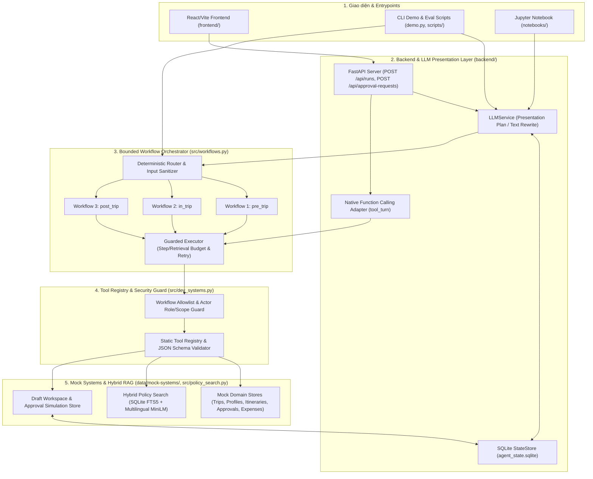
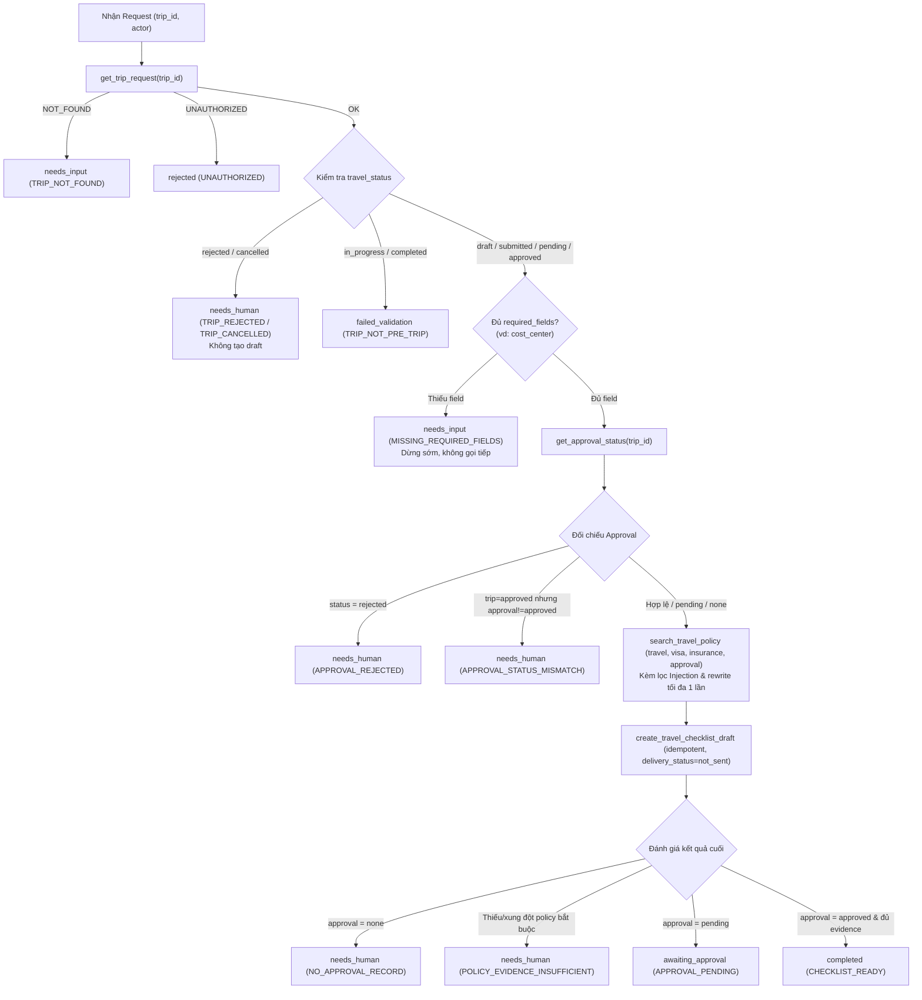
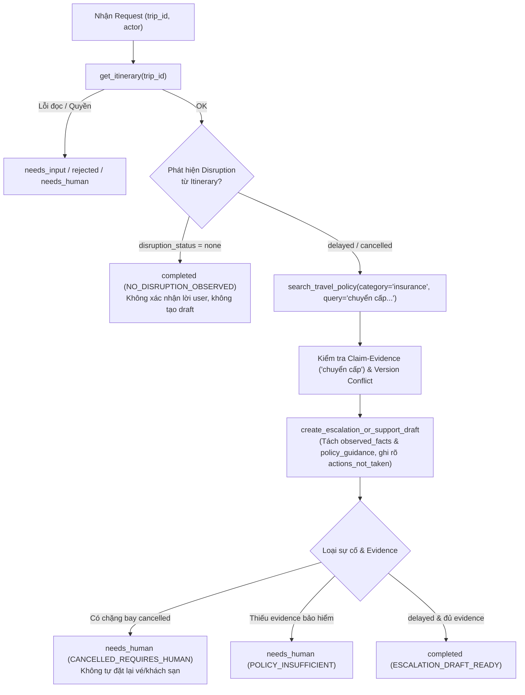
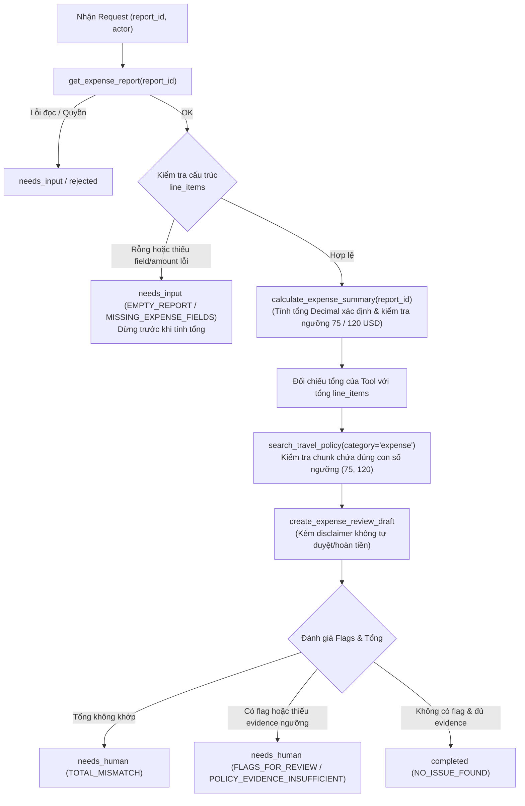

# Tài liệu Bàn giao: Kiến trúc Hệ thống, Sơ đồ Workflow, Tool Registry & Memory Policy

Tài liệu này tổng hợp toàn bộ thiết kế kiến trúc, luồng điều phối 3 workflows bắt buộc, danh mục Tool Registry/Schemas/Allowlist và chính sách Quản lý State/Memory của **Global Business Travel Operations Agent**.

---

## 1. Sơ đồ Kiến trúc Tổng thể (System Architecture)

Hệ thống được thiết kế theo nguyên tắc **Defense-in-Depth (Phòng thủ nhiều lớp)**:
- **Mock-only & Draft-only Side Effects:** Mọi thao tác đọc/ghi chỉ diễn ra trên hệ thống giả lập (`data/mock-systems/` và SQLite `agent_state.sqlite`). Không đặt vé, không thanh toán, không hoàn tiền, không gửi email/tin nhắn thật.
- **Deterministic Orchestration & Guarded Tool Execution:** LLM không được tự ý gọi tool ngoài allowlist hoặc thay đổi kết quả nghiệp vụ/số tiền/trạng thái phê duyệt.
- **Policy is Evidence, Not Authority:** Mọi hướng dẫn quy định đều phải đính kèm citation (`chunk_id`, `doc_id`, `source`, `section`, `version`) và vượt qua bước lọc Prompt Injection + kiểm tra xung đột phiên bản.

---

## 2. Sơ đồ Luồng 3 Workflows Bắt buộc (Workflow Diagrams)

### 2.1. Workflow 1 — Trước chuyến đi (`pre_trip`)

### 2.2. Workflow 2 — Trong chuyến đi (`in_trip`)

### 2.3. Workflow 3 — Sau chuyến đi (`post_trip`)

---

## 3. Danh mục Tool Registry, Schemas & Workflow Allowlist

Mọi lời gọi công cụ đều đi qua `Executor.call()` ([`src/workflows.py`](file:///c:/Users/damlo/OneDrive/Documents/GitHub/Global-Business-Travel-Operations-Agent/src/workflows.py)) và `MockSystems.__call__()` ([`src/dev_systems.py`](file:///c:/Users/damlo/OneDrive/Documents/GitHub/Global-Business-Travel-Operations-Agent/src/dev_systems.py)) theo thứ tự kiểm tra nghiêm ngặt:
1. Tên tool tồn tại trong `registry` tĩnh.
2. Tool nằm trong `workflow_allowlist` của workflow hiện hành.
3. Vai trò (`actor.role`) được phép gọi và `actor.actor_id` có quyền trên bản ghi (`_scope_ok`).
4. Tham số khớp tuyệt đối với JSON Schema (`additionalProperties: false`).
5. Kiểm tra ngân sách (`max_steps=12`, `max_retrieval=6`, `max_retries=2`).

| Tên Tool | Phân loại (`permission_class`) | Workflow Allowlist | Vai trò được phép (`roles`) | Input Schema (`additionalProperties: false`) | Idempotent |
| :--- | :--- | :--- | :--- | :--- | :--- |
| `get_trip_request` | `read_only` | `pre_trip`, `in_trip` | `employee`, `travel_operations_reviewer`, `approver` | `{"trip_id": "^TRIP-\\d{4}-\\d{3}$"}` | Có |
| `get_traveler_profile` | `read_only` | `pre_trip` | `employee`, `travel_operations_reviewer`, `approver` | `{"traveler_id": "^EMP-\\d{3}$"}` | Có |
| `get_itinerary` | `read_only` | `in_trip` | `employee`, `travel_operations_reviewer`, `approver` | `{"trip_id": "^TRIP-\\d{4}-\\d{3}$"}` | Có |
| `get_approval_status` | `read_only` | `pre_trip` | `employee`, `travel_operations_reviewer`, `approver` | `{"trip_id": "^TRIP-\\d{4}-\\d{3}$"}` | Có |
| `search_travel_policy` | `read_only` | `pre_trip`, `in_trip`, `post_trip` | `employee`, `travel_operations_reviewer`, `approver` | `{"query": "str(2..200)", "category": "travel\|expense\|visa\|insurance\|approval", "max_results": "int(1..5)"}` | Có |
| `get_expense_report` | `read_only` | `post_trip` | `employee`, `travel_operations_reviewer`, `approver` | `{"report_id": "^(EXP\|RPT)-\\d{4}-\\d{3}$"}` | Có |
| `calculate_expense_summary` | `deterministic` | `post_trip` | `employee`, `travel_operations_reviewer`, `approver` | `{"report_id": "^(EXP\|RPT)-\\d{4}-\\d{3}$"}` | Có |
| `create_travel_checklist_draft` | `draft_only` | `pre_trip` | `employee`, `travel_operations_reviewer` | `{"payload": "object", "source_ids": "array<str>", "idempotency_key": "str(4..120)"}` | Có (theo `(actor_id, key)`) |
| `create_escalation_or_support_draft` | `draft_only` | `in_trip` | `employee`, `travel_operations_reviewer` | `{"payload": "object", "source_ids": "array<str>", "idempotency_key": "str(4..120)"}` | Có (theo `(actor_id, key)`) |
| `create_expense_review_draft` | `draft_only` | `post_trip` | `employee`, `travel_operations_reviewer` | `{"payload": "object", "source_ids": "array<str>", "idempotency_key": "str(4..120)"}` | Có (theo `(actor_id, key)`) |
| `request_approval` | `approval_simulation` | `pre_trip` (chỉ khi `explicit_approval_request=True`) | `employee`, `travel_operations_reviewer` | `{"trip_id": "^TRIP-\\d{4}-\\d{3}$", "action_summary": "str(8..240)", "idempotency_key": "str(4..120)"}` | Có (chỉ tạo `status=pending`) |

---

## 4. Chính sách Quản lý State & Memory (Memory Policy)

Được triển khai tại [`backend/state_store.py`](file:///c:/Users/damlo/OneDrive/Documents/GitHub/Global-Business-Travel-Operations-Agent/backend/state_store.py) và [`src/workflows.py`](file:///c:/Users/damlo/OneDrive/Documents/GitHub/Global-Business-Travel-Operations-Agent/src/workflows.py):

1. **Tách biệt 4 lớp trạng thái (State Separation):**
   - **Run State (`RunState` & bảng `runs`):** Tồn tại riêng cho từng `run_id`. Ghi nhận `workflow`, `phase`, `step_count`, `retrieval_calls`, `outcome`, `reason_code`, danh sách `artifact_ids`, `evidence_chunk_ids` và `trace` đã làm sạch.
   - **Session Context (bảng `sessions`):** Khóa chặt theo cặp `(actor_id, session_id)`. Chỉ được phép giữ khóa `active_trip_id` hợp lệ (`^TRIP-\d{4}-\d{3}$`) để hỗ trợ hội thoại nối tiếp trong cùng phiên của cùng một người dùng.
   - **User Preferences (bảng `preferences`):** Chỉ lưu các tùy chọn không nhạy cảm nằm trong allowlist (`seat_preference`, `meal_preference`, `Departure_time_preference`, `route_preference`, `checkin_preference`, `preferred_language`, `notification_format`) khi có hành động opt-in rõ ràng.
   - **Sandbox Workspace (bảng `drafts` và `approval_simulations`):** Lưu bản nháp với `delivery_status="not_sent"` và các bản ghi yêu cầu phê duyệt giả lập (`status="pending"`), khóa idempotency theo `(actor_id, idempotency_key)`.

2. **Không dùng Memory cũ làm nguồn sự thật (Memory is Never Source of Truth):**
   - Ngay cả khi `active_trip_id` được lấy từ `session`, Agent **bắt buộc** gọi lại `get_trip_request`, `get_approval_status`, `get_itinerary` hoặc `get_expense_report` từ Mock System trong mỗi lượt chạy.
   - Nếu trạng thái phê duyệt trong Mock System đổi từ `pending` sang `rejected` (được kiểm chứng bởi `EVAL-018`), lượt chạy tiếp theo lập tức phản ánh `APPROVAL_REJECTED`.

3. **Cô lập dữ liệu & Bảo vệ quyền riêng tư (Isolation & Redaction):**
   - Session của `EMP-001` không bao giờ nhìn thấy được bởi `EMP-002`.
   - Bộ lọc `_safe()` trong `RunState` và `_sanitize_trace()` trong `StateStore` tự động thay thế mọi khóa nhạy cảm (`passport`, `visa_no`, `card`, `account`, `token`, `password`, `secret`, `address`, `payload`, `action_summary`) bằng `"[redacted]"` trước khi lưu xuống SQLite hoặc trả về API.
